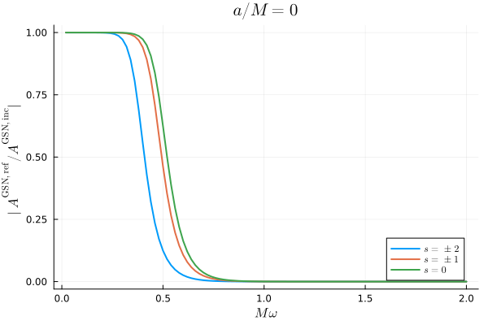
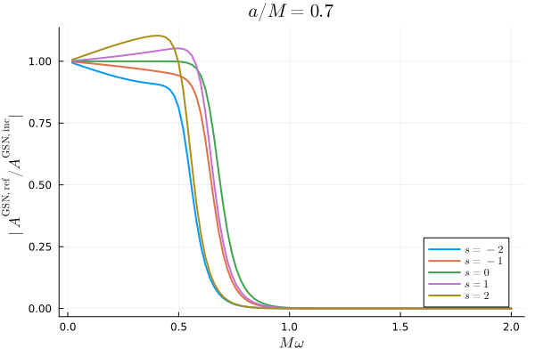
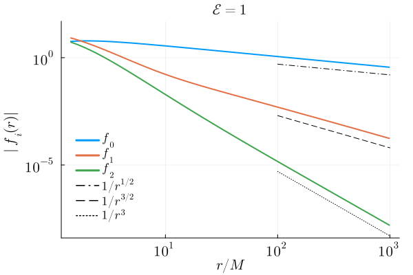
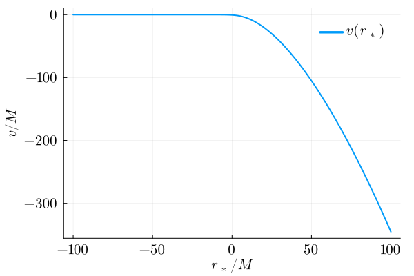
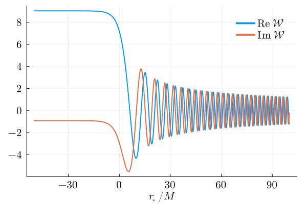
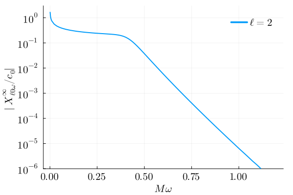
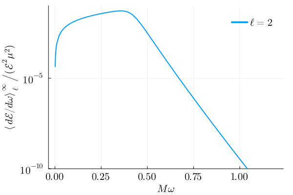
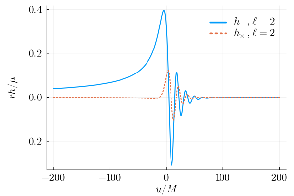

# Examples

```@contents
Pages = ["examples.md"]
```

Each example links its notebook in
[`examples/`](https://github.com/ricokaloklo/GeneralizedSasakiNakamura.jl/tree/main/examples).
Add the packages the examples use (Example 4 also uses the standard library
`Statistics`):

```julia
using Pkg
Pkg.add(["Plots", "LaTeXStrings", "SpinWeightedSpheroidalHarmonics",
    "DifferentialEquations", "CubicSplines", "QuadGK"])
```

## Example 1: ISEM radial functions

Notebook: [examples/GSN-function.ipynb](https://github.com/ricokaloklo/GeneralizedSasakiNakamura.jl/blob/main/examples/GSN-function.ipynb)

ISEM (iterative series expansion matching) solves the generalized
Sasaki-Nakamura (GSN) equation for the GSN function $X$ directly.
`Teukolsky_radial` converts that solution into the Teukolsky function $R$, and
`Y_radial` into $Y$, the auxiliary function used by the point-particle
convolutions: $Y \propto e^{-i\phi(r)}R/r^2$ for $s=-2$ with `IN` and
$Y \propto e^{i\phi(r)}\Delta^2R/r^2$ for $s=+2$ with `UP` (the only two cases),
where $d\phi/dr = K/\Delta$, $K = (r^2+a^2)\omega - am$ and
$\Delta = r^2 - 2r + a^2$. `method = "ISEM"` never falls back to another
solver. With the default `"auto"`, `GSN_radial` and `Teukolsky_radial` try ISEM
first and, if ISEM fails and no `xm` was given, fall back to the ODE methods
with a warning; `Y_radial` never falls back.

```julia
using GeneralizedSasakiNakamura
using Plots, LaTeXStrings

s = -2
l = 2
m = 2
a = 0.7
omega = 0.25
bc = IN

X = GSN_radial(s, l, m, a, omega, bc; method = "ISEM")
R = Teukolsky_radial(s, l, m, a, omega, bc; method = "ISEM")
Y = Y_radial(s, l, m, a, omega, bc; method = "ISEM")

rstar_grid = collect(range(-30, 100; length = 1400))
r_grid = r_from_rstar.(a, rstar_grid)

x_state = X.GSN_solution.(rstar_grid)
r_state = R.Teukolsky_solution.(r_grid)
y_state = Y.Y_solution.(r_grid)
```

```julia
X_values = getindex.(x_state, 1)
dXdrstar_values = getindex.(x_state, 2)
R_values = getindex.(r_state, 1)
Y_values = getindex.(y_state, 1)

pX = plot(rstar_grid, [real.(X_values) imag.(X_values)];
    label = ["real" "imag"], xlabel = L"r_*/M", ylabel = L"X(r_*)",
    title = "GSN function X")
pR = plot(r_grid, [real.(R_values) imag.(R_values)];
    label = ["real" "imag"], xlabel = L"r/M", ylabel = L"R(r)",
    title = "Teukolsky function R")
pY = plot(r_grid, [real.(Y_values) imag.(Y_values)];
    label = ["real" "imag"], xlabel = L"r/M", ylabel = L"Y(r)",
    title = "Auxiliary function Y")

plot(pX, pR, pY; layout = (3, 1), size = (900, 960))
```

`X(rstar)` evaluates $X$ at the tortoise coordinate $r_*$; `R(r)` and `Y(r)`
take the Boyer-Lindquist radius $r$. The fields
`X.GSN_solution`, `R.Teukolsky_solution` and `Y.Y_solution` used above return
tuples that start with the value and its derivative in the same coordinate, so
$dX/dr_*$ comes with no extra work:

```julia
plot(rstar_grid, [real.(dXdrstar_values) imag.(dXdrstar_values)];
    label = ["real" "imag"], xlabel = L"r_*/M", ylabel = L"dX/dr_*",
    title = "dX/dr_*, returned together with X")
```

## Example 2: Kerr quasinormal modes

Notebook: [examples/qnm-interface.ipynb](https://github.com/ricokaloklo/GeneralizedSasakiNakamura.jl/blob/main/examples/qnm-interface.ipynb)

`qnm(a, s, l, m, n)` computes one QNM (units $G=c=M=1$): its frequency, GSN
amplitudes and excitation factor. It returns the `ordinary` mode
($\operatorname{Re}\omega > 0$); `qnm(a, s, l, m, n, mirror)` returns the
`mirror` mode ($\operatorname{Re}\omega < 0$).

```julia
using GeneralizedSasakiNakamura

ordinary_mode = qnm(0.68, -2, 2, 2, 0)
```

```text
QuasiNormalMode(
    parameters = (a = 0.68, s = -2, l = 2, m = 2, n = 0)
    omega = 0.52397510429008398 - 0.081512623631199516im
    lambda = 1.6550030612535795 + 0.36026776076186151im
    incidence_amplitude = -2.9652484956329296e-15 + 1.0066747053005698e-14im
    reflection_amplitude = -0.80073261705109955 + 0.029136276807086189im
    incidence_derivative = -2.143807932934116 + 6.7875557748638862im
    excitation_factor = 0.01983394079017144 + 0.10427056860707475im
    formalism = GSN)
```

This `QNMResult` (displayed as `QuasiNormalMode`) passed every accuracy check.
Otherwise `qnm` returns a `QNMEstimate` or a `QNMFailure`; a zero-damping
mode at $a = \pm 1$ gives a `QNMEndpointResult` without amplitudes. Check
`.status` before using the values. The fields are

```julia
ordinary_mode.omega                  # QNM frequency ω
ordinary_mode.lambda                 # separation constant λ of the radial Teukolsky equation
ordinary_mode.incidence_amplitude    # A^{GSN,inc}, which vanishes at a QNM
ordinary_mode.reflection_amplitude   # A^{GSN,ref}
ordinary_mode.incidence_derivative   # α = dA^{GSN,inc}/dω at the QNM frequency
ordinary_mode.excitation_factor      # A^{GSN,ref}/(2ωα)
```

where $A^{{\rm GSN},{\rm inc}}$ and $A^{{\rm GSN},{\rm ref}}$ are the incidence
and reflection amplitudes of the `IN` GSN solution with unit transmission
amplitude.

With `detailed=true`, `qnm` also returns the radial solutions at the QNM
frequency: `X` and `R` are the `IN` solutions with unit GSN and unit Teukolsky
transmission amplitude, and `Y` is the `IN` solution for $s=-2$ (the `UP`
solution for $s=+2$, `missing` otherwise). `X` takes $r_*$, while `Y` and `R`
take $r$:

```julia
detailed = qnm(0.68, -2, 2, 2, 0; detailed=true)
r = 10.0
rstar = rstar_from_r(0.68, r)

(X = detailed.X(rstar), Y = detailed.Y(r), R = detailed.R(r))
```

```text
(X = -1.0392692738424993 - 1.6891143363807735im, Y = 0.6028384381375009 + 0.14047607467470857im, R = 992.3634889462411 - 381.00316036321533im)
```

For the frequency alone, `qnm_frequency(a, s, l, m, n)` returns a `LeaverResult`
(frequency in `.omega`), and `qnm_sequence(spins, s, l, m, n)` follows the mode
along a list of spins, returning one `LeaverResult` per spin up to and
including the first root that is not accepted:

```julia
root = qnm_frequency(0.68, -2, 2, 2, 0)
roots = qnm_sequence([0.0, 0.3, 0.68], -2, 2, 2, 0)

(root.omega, [r.omega for r in roots])
```

```text
(0.523975104290084 - 0.08151262363119952im, ComplexF64[0.3736716844180418 - 0.08896231568893566im, 0.41952668176385144 - 0.08772927189431194im, 0.523975104290084 - 0.08151262363119957im])
```

Two keywords matter for some high overtones (full rules in
[Quasinormal modes](@ref)). For $s=-2$, $\ell=2$, $|m|=2$ co-rotating modes ($am>0$ for
`ordinary`, $am<0$ for `mirror`), the Schwarzschild root $-2i$ splits at
$a\neq0$ into Cook & Zalutskiy's $8_0$ (less damped) and $8_1$: the default
`convention = :overtone` returns $8_0$ for `n = 8` and has no label for $8_1$,
which `convention = :complete_spectrum` returns for `n = 9`. The $s=-2$,
$\ell=2$, $m=0$, `n = 10` sequence ends on the negative imaginary axis near
$a\approx0.39$ and reappears at larger spin ($10_1$). Beyond its end the
default `segment = 0` fails, and `segment = 1` returns the reappearing piece:

```julia
(n8 = qnm_frequency(0.68, -2, 2, 2, 8).omega,
 n8_1 = qnm_frequency(0.68, -2, 2, 2, 9; convention=:complete_spectrum).omega)

(segment0 = qnm_frequency(0.5, -2, 2, 0, 10).stop_reason,
 segment1 = qnm_frequency(0.5, -2, 2, 0, 10; segment=1).omega)
```

```text
(n8 = 0.410769950743262 - 1.5086151268999994im, n8_1 = 0.4091276402272317 - 1.712771299136728im)
(segment0 = :negative_imaginary_axis_endpoint, segment1 = 0.05104369416307723 - 2.5823555488023113im)
```

## Example 3: Ratio of reflected to incident GSN amplitudes

Notebook: [examples/plot-reflectivity.ipynb](https://github.com/ricokaloklo/GeneralizedSasakiNakamura.jl/blob/main/examples/plot-reflectivity.ipynb)

For each frequency we solve for the `IN` GSN function. At infinity
$X^{\rm in} \to A^{{\rm GSN},{\rm inc}} e^{-i\omega r_*} + A^{{\rm GSN},{\rm ref}} e^{+i\omega r_*}$,
and we plot $|A^{{\rm GSN},{\rm ref}}/A^{{\rm GSN},{\rm inc}}|$
(`reflection_amplitude/incidence_amplitude`). This ratio depends on how the
GSN function is defined and is not the energy reflectivity of the black hole.
At $a = 0$ the curves for $s$ and $-s$ coincide, so only $s = -2, -1, 0$ are
computed. At $a = 0.7$ they differ: the ratio rises above 1 at low frequency
for $s = 1, 2$ and stays below 1 for $s = -1, -2$. This does not mark
superradiance, which occurs for every $s$ at $\omega < m\Omega_H \approx 0.41$.

```julia
using GeneralizedSasakiNakamura
using Plots, LaTeXStrings

function reflectivity_curve(s, l, m, a, omegas)
    return [begin
        Xin = GSN_radial(s, l, m, a, omega, IN; method = "ISEM")
        Xin.reflection_amplitude / Xin.incidence_amplitude
    end for omega in omegas]
end

l = 2
m = 2
omegas = collect(range(0.02, 2.0; length = 100))
```

```julia
nonrotating = Dict(s => reflectivity_curve(s, l, m, 0.0, omegas) for s in (-2, -1, 0))

plot(omegas, abs.(nonrotating[-2]); linewidth = 2, label = L"s = \pm 2")
plot!(omegas, abs.(nonrotating[-1]); linewidth = 2, label = L"s = \pm 1")
plot!(omegas, abs.(nonrotating[0]); linewidth = 2, label = L"s = 0")
plot!(; xlabel = L"M\omega", ylabel = L"|A^{\mathrm{GSN,ref}}/A^{\mathrm{GSN,inc}}|",
    title = L"a/M=0", legend = :bottomright)
```

```julia
rotating = Dict(s => reflectivity_curve(s, l, m, 0.7, omegas) for s in -2:2)

plot(omegas, abs.(rotating[-2]); linewidth = 2, label = L"s = -2")
for s in -1:2
    plot!(omegas, abs.(rotating[s]); linewidth = 2, label = latexstring("s = $s"))
end
plot!(; xlabel = L"M\omega", ylabel = L"|A^{\mathrm{GSN,ref}}/A^{\mathrm{GSN,inc}}|",
    title = L"a/M=0.7", legend = :bottomright)
```


## Example 4: Waveform of a particle falling radially into a Kerr black hole

Notebook: [examples/radialinfall-infinity.ipynb](https://github.com/ricokaloklo/GeneralizedSasakiNakamura.jl/blob/main/examples/radialinfall-infinity.ipynb)

This example follows Yin, Lo & Chen, Phys. Rev. D 113, 124007 (2026), [arXiv:2511.08673](https://arxiv.org/abs/2511.08673); figure numbers refer to the arXiv version. A particle starts from rest at infinity (the paper's rest limit, orbital energy per unit mass $\mathcal{E}=1$) and falls along the spin axis ($\theta=0$) of a Kerr black hole; we compute the gravitational waveform.

The package's point-particle functions (`Teukolsky_pointparticle_mode`, `GSN_pointparticle_mode`, `Teukolsky_pointparticle_flux`) take bound orbits specified by $(a, p, e, x)$. This plunge is not one, so we build the source and the convolution integral by hand and use the package for the homogeneous GSN solution (`GSN_radial`) and `r_from_rstar`.

Notation ($G=c=M=1$): $\Delta=r^2-2r+a^2$, $\Sigma=r^2+a^2\cos^2\theta$, $\rho=-1/(r-ia\cos\theta)$, $S={}_{-2}S_{\ell 0}^{a\omega}(\theta)$ is the spin-weighted spheroidal harmonic, and $\mathscr{L}_n^\dagger=\partial_\theta+a\omega\sin\theta+n\cot\theta$ (for $m=0$). $\mu$ is the mass of the particle, and $(u,\theta,\varphi)$ are the retarded time $u=t-r_*$ and the angles of the observer. $X^\infty_{\ell m\omega}$ is the coefficient of $e^{i\omega r_*}$ as $r_*\to\infty$ of the $s=-2$ GSN function sourced by the particle, per unit $\mu$; the Teukolsky amplitude there is $-4\omega^2/c_0$ times $X^\infty_{\ell m\omega}$, where $c_0=\lambda(\lambda+2)-12i\omega-12a\omega(a\omega-m)$ and $\lambda$ is the separation constant of the radial Teukolsky equation. $\xi(r)$ and $\mathscr{A}$ are defined in the paper for general orbits.


```julia
using GeneralizedSasakiNakamura
using SpinWeightedSpheroidalHarmonics
using DifferentialEquations
using Statistics
using CubicSplines
using QuadGK
using Plots, LaTeXStrings
```

Construct the source term 

$\mathcal{W}_{nn}=f_0(r)e^{i\chi(r)}+\int_{r}^\infty f_1(r_1)e^{i\chi(r_1)}d r_1+\int_r^\infty dr_1\int_{r_1}^\infty f_2(r_2)e^{i\chi(r_2)}dr_2,$

where

$f_0(r)=\frac{\mathscr{A}}{\omega^2}w_{nn}^{(0)}(r),$ 

$f_1(r)=\frac{\mathscr{A}}{\omega^2}\left[{w_{nn}^{(0)}}'(r)+i\xi(r)w_{nn}^{(0)}(r)+w_{nn}^{(1)}(r)\right],$ 

$f_2(r)=\frac{\mathscr{A}}{\omega^2}\left[{w_{nn}^{(1)}}'(r)+i\xi(r)w_{nn}^{(1)}(r)\right],$

$\chi(r)=\omega \left[t(r)+r_*(r)\right],$

with

$w_{nn}^{(0)}(r)=\frac{1}{2}r^2\rho\bar{\rho}^2u^r \mathscr{L}_1^\dagger\left[\rho^{-4}\mathscr{L}_2^\dagger\left(\rho^3S\right)\right],$

$w_{nn}^{(1)}(r)=w_{nn}^{(0)}(r)\left(\frac{\mathcal{N}}{u^r}\right)'\frac{u^r}{\mathcal{N}}+{w_{nn}^{(0)}}'(r)+i\xi(r)w_{nn}^{(0)}(r).$

In our case $\xi(r)\equiv 0$, $\mathscr{A}=-1$ and 

$u^t=\frac{r^2+a^2}{\Delta},$

$u^r=-\sqrt{\frac{2r}{r^2+a^2}},$

$\mathcal{N}=u^t+\frac{\Sigma}{\Delta}u^r=\frac{r^2+a^2}{\Delta}\left(1-\sqrt{\frac{2r}{r^2+a^2}}\right).$

Both $\Delta$ and the bracket vanish at $r_+$, but with $q=\sqrt{2r/(r^2+a^2)}$ one has $\Delta=(r^2+a^2)(1-q^2)$, so $\mathcal{N}=1/(1+q)$, which is regular, with $\mathcal{N}(r_+)=1/2$. `N_expansions` below returns $\mathcal{N}$, $\mathcal{N}'$ and $\mathcal{N}''$ from this closed form, except near the horizon, $x=r-r_+<3\times10^{-3}$, where it uses their series in $x$ up to $x^5$ (relative accuracy $10^{-12}$):

$\mathcal{N}(r\to r_+)=n^0_0+n^0_1x+n^0_2x^2+\dots,$

$\mathcal{N}'(r\to r_+)=n^1_0+n^1_1x+n^1_2x^2+\dots,$

$\mathcal{N}''(r\to r_+)=n^2_0+n^2_1x+n^2_2x^2+\dots.$


```julia
function N_expansions(r, a)
    rp = 1 + sqrt(1 - a^2)
    x = r - rp
    # We find it more convenient to work with ν = arcsin(a)
    ν = asin(a)
    if x < 3e-3
        # The expansion coefficients of N
        n00 = 1 / 2
        n01 = 1 / (8 + 8 * sec(ν))
        n02 = (sin(ν)^2 - cos(ν)) / (16 * (1 + cos(ν))^2)
        n03 = (5 * cos(ν)^3 - 8 * sin(ν)^2) / (128 * (1 + cos(ν))^3)
        n04 = (-7 * cos(ν) + (19 + 15 * cos(ν)) * sin(ν)^2 - 7 * sin(ν)^4)/(256 * (1 + cos(ν))^4)
        n05 = (21 * cos(ν) - 4 * (15 + 19 * cos(ν) + 7 * cos(2 * ν)) * sin(ν)^2
             + 21 * cos(ν) * sin(ν)^4)/(1024 * (1 + cos(ν))^5)
        N = n00 + n01 * x + n02 * x^2 + n03 * x^3 + n04 * x^4 + n05 * x^5

        # The expansion coefficients of N'
        n10 = 1/(8 + 8 * sec(ν))
        n11 = -(1/64) * (-1 + 2 * cos(ν) + cos(2 * ν)) * sec(ν/2)^4
        n12 = (3 * (-16 + 15 * cos(ν) + 16 * cos(2 * ν) + 5 * cos(3 * ν)) * sec(ν/2)^6)/4096
        n13 = -(((-55 + 26 * cos(ν) + 48 * cos(2 * ν) + 30 * cos(3 * ν) 
            + 7 * cos(4 * ν)) * sec(ν/2)^8)/8192)
        n14 = (5 * (-368 + 74 * cos(ν) + 256 * cos(2 * ν) + 241 * cos(3 * ν) 
            + 112 * cos(4 * ν) + 21 * cos(5 * ν)) * sec(ν/2)^10)/524288
        n15 = -((3 * (-1234 + 36 * cos(ν) + 639 * cos(2 * ν) + 810 * cos(3 * ν) 
            + 562 * cos(4 * ν) + 210 * cos(5 * ν) + 33 * cos(6 * ν)) * sec(ν/2)^12)/2097152)
        Np = n10 + n11 * x + n12 * x^2 + n13 * x^3 + n14 * x^4 + n15 * x^5

        # The expansion coefficients of N''
        n20 = -(1/64) * (-1 + 2 * cos(ν) + cos(2 * ν)) * sec(ν/2)^4
        n21 = (3 * (-16 + 15 * cos(ν) + 16 * cos(2 * ν) + 5 * cos(3 * ν)) * sec(ν/2)^6)/2048
        n22 = -((3 * (-55 + 26 * cos(ν) + 48 * cos(2 * ν) + 30 * cos(3 * ν) 
            + 7 * cos(4 * ν)) * sec(ν/2)^8)/8192)
        n23 = (5 * (-368 + 74 * cos(ν) + 256 * cos(2 * ν) + 241 * cos(3 * ν) + 112 * cos(4 * ν) 
            + 21 * cos(5 * ν)) * sec(ν/2)^10)/131072
        n24 = -((15 * (-1234 + 36 * cos(ν) + 639 * cos(2 * ν) + 810 * cos(3 * ν) + 562 * cos(4 * ν) 
            + 210 * cos(5 * ν) + 33 * cos(6 * ν)) * sec(ν/2)^12)/2097152)
        n25 = (1/134217728) * 21 * (-33472 - 2777 * cos(ν) + 12192 * cos(2 * ν) + 19697 * cos(3 * ν) 
            + 18112 * cos(4 * ν) + 10107 * cos(5 * ν) + 3168 * cos(6 * ν) + 429 * cos(7 * ν)) * sec(ν/2)^14
        Npp = n20 + n21 * x + n22 * x^2 + n23 * x^3 + n24 * x^4 + n25 * x^5
    else
        N = 1/(1 + (sqrt(2) * r)/sqrt(r * (a^2 + r^2)))
        Np = (-a^2 * r + r^3)/(sqrt(2) * sqrt(r * (a^2 + r^2)) * (sqrt(2) * r + sqrt(r * (a^2 + r^2)))^2)
        Npp = (r * (a^4 * (6 * r + sqrt(2) * sqrt(r * (a^2 + r^2))) - r^4 * (2 * r 
            + 3 * sqrt(2) * sqrt(r * (a^2 + r^2))) + 2 * a^2 * r^2 * (6 * r + 5 * sqrt(2) 
            * sqrt(r * (a^2 + r^2))))) / (4 * (r * (a^2 + r^2))^(3/2) * (sqrt(2) * r + sqrt(r * (a^2 + r^2)))^3)
    end
    return N, Np, Npp
end
```

We define 

$P = \frac{1}{2}r^2\rho\bar{\rho}^2=-\frac{r^2}{2(r-ia)(r+ia)^2},$

$Q = \mathscr{L}_1^\dagger\left[\rho^{-4}\mathscr{L}_2^\dagger\left(\rho^3S\right)\right] = 4(ia-r)\left.\frac{\partial^2{}_{-2}S_{\ell 0}^{a\omega}(\theta)}{\partial\theta^2}\right|_{\theta=0},$

$U = u^r.$

The components in $f_{0,1,2}$ will be

$w_{nn}^{(0)} = PUQ,$

${w_{nn}^{(0)}}' = P'UQ+PU'Q+PUQ',$

${w_{nn}^{(0)}}''=P''UQ+PU''Q+PUQ''+2P'U'Q+2P'UQ'+2PU'Q',$

${w_{nn}^{(1)}} = w_{nn}^{(0)}\left(\frac{\mathcal{N}'}{\mathcal{N}}-\frac{U'}{U}\right)+{w_{nn}^{(0)}}',$

${w_{nn}^{(1)}}' = {w_{nn}^{(0)}}'(\frac{\mathcal{N}'}{\mathcal{N}}-\frac{U'}{U})+{w_{nn}^{(0)}}\left[\frac{\mathcal{N}''}{\mathcal{N}}-\left(\frac{\mathcal{N}'}{\mathcal{N}}\right)^2-\frac{U''}{U}+\left(\frac{U'}{U}\right)^2\right]+{w_{nn}^{(0)}}''.$

`f_terms` gives $f_{0,1,2}$ as functions of $r$:


```julia
function f_terms(a, ω, S2)
    function f_r(r)
        N, Np, Npp = N_expansions(r, a)

        P = - r^2 / (2 * (-im*a + r) * (im*a + r)^2)
        Pp = (r * (-2*a^2 - im*a*r + r^2))/(2 * (-im*a + r)^2 * (im*a + r)^3)
        Ppp = (im * (a^4 + 2*im*a^3*r - 6*a^2*r^2 - 2*im*a*r^3 + r^4))/((a - im*r)^4 * (a + im*r)^3)

        Q = 4 * (im * a - r) * S2
        Qp =  - 4 * S2
        Qpp = 0

        U = -((sqrt(2) * r)/sqrt(r * (a^2 + r^2)))
        Up = (r * (-a^2 + r^2))/(sqrt(2) * (r * (a^2 + r^2))^(3/2))
        Upp = (r * (a^4 + 10 * a^2 * r^2 - 3 * r^4))/(2 * sqrt(2) * (r * (a^2 + r^2))^(5/2))

        wnn0 = P*U*Q
        dwnn0 = Pp*U*Q + P*Up*Q + P*U*Qp
        ddwnn0 = Ppp*U*Q + P*Upp*Q + P*U*Qpp + 2*Pp*Up*Q + 2*Pp*U*Qp + 2*P*Up*Qp
        wnn1 = wnn0 * (Np/N - Up/U) + dwnn0
        dwnn1 = dwnn0 * (Np/N - Up/U) + wnn0 * (Npp/N - (Np/N)^2 - Upp/U + (Up/U)^2) + ddwnn0

        f0 = - wnn0 / ω^2
        f1 = - (wnn1 + dwnn0) / ω^2
        f2 = - dwnn1 / ω^2

        return f0, f1, f2
    end
    return f_r
end
```

The code below reproduces Figure 5(a). Since $f_{0,1,2}$ are proportional to $S''(0)$ (`S2`), it sets `S2 = 1` to show their dependence on $r$.


```julia
rs_values = range(-100, 1000, 1000)
a = 0.9
ω = 0.5
S2 = 1
f_r = f_terms(a, ω, S2)
r_values = [r_from_rstar(a, r) for r in rs_values]
f0_values = [abs(f_r(r)[1]) for r in r_values]
f1_values = [abs(f_r(r)[2]) for r in r_values]
f2_values = [abs(f_r(r)[3]) for r in r_values]
r_benchmark = 10 .^range(2, 3, 20)
r_to_minus_half = [5*r^(-0.5) for r in r_benchmark]
r_to_minus_onehalf = [2*r^(-1.5) for r in r_benchmark]
r_to_minus_three = [5*r^(-3.0) for r in r_benchmark]

f_terms_rest = plot(r_values,
    f0_values,
    xlabel = L"r/M",
    ylabel = L"|f_i(r)|",
    label = L"f_0",
    legendfont = font(12,"Computer Modern"),
    legendfontsize=14,
    xguidefontsize=14,
    yguidefontsize=14,
    xtickfontsize=14,
    ytickfontsize=14,
    foreground_color_legend=nothing,
    background_color_legend=nothing,
    legend=:topright,
    formatter=:latex,
    yscale =:log10,
    xscale =:log10,
    linewidth=2.0,
    left_margin = 2Plots.mm,
    right_margin = 3Plots.mm)
plot!(r_values,
    f1_values,
    xlabel = L"r/M",
    label = L"f_1",
    legendfont = font(12,"Computer Modern"),
    legendfontsize=14,
    xguidefontsize=14,
    yguidefontsize=14,
    xtickfontsize=14,
    ytickfontsize=14,
    foreground_color_legend=nothing,
    background_color_legend=nothing,
    legend=:topright,
    formatter=:latex,
    yscale =:log10,
    xscale =:log10,
    linewidth=2.0,
    left_margin = 2Plots.mm,
    right_margin = 3Plots.mm)
plot!(r_values,
    f2_values,
    xlabel = L"r/M",
    label = L"f_2",
    legendfont = font(12,"Computer Modern"),
    legendfontsize=14,
    xguidefontsize=14,
    yguidefontsize=14,
    xtickfontsize=14,
    ytickfontsize=14,
    foreground_color_legend=nothing,
    background_color_legend=nothing,
    legend=:topright,
    formatter=:latex,
    yscale =:log10,
    xscale =:log10,
    linewidth=2.0,
    left_margin = 2Plots.mm,
    right_margin = 3Plots.mm)
plot!(r_benchmark,
    r_to_minus_half,
    xlabel = L"r/M",
    label = L"1/r^{1/2}",
    legendfont = font(12,"Computer Modern"),
    legendfontsize=14,
    xguidefontsize=14,
    yguidefontsize=14,
    xtickfontsize=14,
    ytickfontsize=14,
    foreground_color_legend=nothing,
    background_color_legend=nothing,
    legend=:topright,
    formatter=:latex,
    yscale =:log10,
    xscale =:log10,
    linewidth=1.0,
    left_margin = 2Plots.mm,
    right_margin = 3Plots.mm,
    color =:black,
    linestyle =:dashdot)
plot!(r_benchmark,
    r_to_minus_onehalf,
    xlabel = L"r/M",
    label = L"1/r^{3/2}",
    legendfont = font(12,"Computer Modern"),
    legendfontsize=14,
    xguidefontsize=14,
    yguidefontsize=14,
    xtickfontsize=14,
    ytickfontsize=14,
    foreground_color_legend=nothing,
    background_color_legend=nothing,
    legend=:topright,
    formatter=:latex,
    yscale =:log10,
    xscale =:log10,
    linewidth=1.0,
    left_margin = 2Plots.mm,
    right_margin = 3Plots.mm,
    color =:black,
    linestyle =:dash)
plot!(r_benchmark,
    r_to_minus_three,
    xlabel = L"r/M",
    label = L"1/r^3",
    title = L"\mathcal{E}=1",
    legendfont = font(12,"Computer Modern"),
    legendfontsize=12,
    xguidefontsize=14,
    yguidefontsize=14,
    xtickfontsize=14,
    ytickfontsize=14,
    foreground_color_legend=nothing,
    background_color_legend=nothing,
    legend=:bottomleft,
    formatter=:latex,
    yscale =:log10,
    xscale =:log10,
    linewidth=1.0,
    color =:black,
    left_margin = 2Plots.mm,
    right_margin = 3Plots.mm,
    linestyle =:dot,
    ylim = (4e-9, 50))
```



For the phase $\chi$, `t_of_rs` integrates

$\frac{dt}{dr_*}=\frac{dt}{dr}\frac{dr}{dr_*}=\frac{u^t}{u^r}\frac{\Delta}{r^2+a^2}=\frac{1}{u^r}$

outwards from $r_*^0=\min(-100,\,50\log_{10}(1-a))$, starting from $t(r_*^0)=-r_*^0$ so that $v=t+r_*$ vanishes there.


```julia
function t_of_rs(rs_out, a)
    function f!(du, u, p, rs)
        r = r_from_rstar(a, rs)
        ur = -((sqrt(2) * r)/sqrt(r * (a^2 + r^2)))
        du[1] = 1 / ur 
    end
    rs_in = min(-100, 50*log10(1-a))
    t0 = - rs_in
    u0 = [t0]
    prob = ODEProblem(f!, u0, (rs_in, rs_out))
    sol = solve(prob, abstol=1e-8, reltol=1e-8)

    return sol, rs_in, rs_out
end
```


```julia
trs = t_of_rs(1000, 0.9)
rs_values = range(-100, 100, 1000)
v_values = [trs[1](rs)[1]+rs for rs in rs_values]
plot(rs_values,
    v_values,
    xlabel = L"r_*/M",
    ylabel = L"v/M",
    label = L"v(r_*)",
    legendfont = font(12,"Computer Modern"),
    legendfontsize=14,
    xguidefontsize=14,
    yguidefontsize=14,
    xtickfontsize=14,
    ytickfontsize=14,
    foreground_color_legend=nothing,
    background_color_legend=nothing,
    legend=:topright,
    formatter=:latex,
    linewidth=2.0,
    left_margin = 2Plots.mm,
    right_margin = 3Plots.mm)
```



We precompute the integrals in $\mathcal{W}_{nn}$ by solving ODEs. Their upper limit $r_*^{\rm max}$ stands in for infinity; `Wnn_integrals` sets it to $3\max(r_*^{\rm out},\,100\pi/|\omega|)$, with $r_*^{\rm out}$ its keyword `rsout`.


```julia
function precompute_W_integral(trs, f, a, omega)
    trs_sol, rsmin, rsmax = trs
    function f1!(du, u, p, rs)
        r = r_from_rstar(a, rs)
        du[1] = - f(r)[2] * exp(1im * omega * (trs_sol(rs)[1] + rs)) * (r^2 - 2*r + a^2)/(r^2 + a^2)
    end
    function f2!(du, u, p, rs)
        r = r_from_rstar(a, rs)
        du[1] = - f(r)[3] * exp(1im * omega * (trs_sol(rs)[1] + rs)) * (r^2 - 2*r + a^2)/(r^2 + a^2)
    end
    
    u0 = ComplexF64[0.0]

    prob1 = ODEProblem(f1!, u0, (rsmax, rsmin))
    sol1 = solve(prob1, abstol=1e-8, reltol=1e-8)
    

    prob2 = ODEProblem(f2!, u0, (rsmax, rsmin))
    sol2 = solve(prob2, abstol=1e-8, reltol=1e-8)

    function f2r!(du, u, p, rs)
        r = r_from_rstar(a, rs)
        du[1] = - sol2(rs)[1] * (r^2 - 2*r + a^2)/(r^2 + a^2)
    end

    prob2r = ODEProblem(f2r!, u0, (rsmax, rsmin))
    sol2r = solve(prob2r, abstol=1e-8, reltol=1e-8)

    return sol1, sol2r
end
```


```julia
function Wnn_integrals(l, a, omega; rsout = 10000)
    SH = spin_weighted_spheroidal_harmonic(-2, l, 0, a*omega)
    S2 = SH(0, 0; theta_derivative=2)

    f = f_terms(a, omega, S2)

    rsout = max(rsout, 100pi*abs(omega)^(-1.0))
    trs = t_of_rs(rsout * 3, a)

    Wnn1, Wnn2 = precompute_W_integral(trs, f, a, omega)

    function Wnn(rs)
        r = r_from_rstar(a, rs)
        χ =  omega * (trs[1](rs)[1] + rs)
        phase = exp(1im * χ)
        W = f(r)[1] * phase + Wnn1(rs)[1] + Wnn2(rs)[1]
        return W
    end
    
    return Wnn
end
```

The code below reproduces Figure 5(b):


```julia
rs_values = range(-50, 100, 1000)
l = 2
a = 0.9
ω = 0.5
W_1 = Wnn_integrals(l, a, ω)
W_values = [W_1(rs)[1] for rs in rs_values]
W1 = plot(rs_values,
    real.(W_values),
    xlabel = L"r_{\!\!\!\! _*}/M",
    label = L"\mathrm{Re}\ \mathcal{W}",
    legendfont = font(12,"Computer Modern"),
    legendfontsize=14,
    xguidefontsize=14,
    yguidefontsize=14,
    xtickfontsize=14,
    ytickfontsize=14,
    foreground_color_legend=nothing,
    background_color_legend=nothing,
    legend=:topright,
    formatter=:latex,
    linewidth=2.0,
    left_margin = 2Plots.mm,
    right_margin = 3Plots.mm)
plot!(rs_values,
    imag.(W_values),
    xlabel = L"r_{\!\!\!\! _*}/M",
    label = L"\mathrm{Im}\ \mathcal{W}",
    legendfont = font(12,"Computer Modern"),
    legendfontsize=14,
    xguidefontsize=14,
    yguidefontsize=14,
    xtickfontsize=14,
    ytickfontsize=14,
    foreground_color_legend=nothing,
    background_color_legend=nothing,
    legend=:topright,
    formatter=:latex,
    linewidth=2.0,
    left_margin = 2Plots.mm,
    right_margin = 3Plots.mm)
```



The Green's-function convolution gives

$\frac{X_{\ell 0\omega}^\infty}{c_0}=\frac{1}{2i\omega A^{{\rm GSN},{\rm inc}}_{\ell 0\omega}}\int_{r_*^{\rm in}}^{r_*^{\rm out}}\frac{\Delta X_{\ell 0 \omega}^{\rm in}(r_*)\mathcal{W}_{nn}(r_*)}{r^2(r^2+a^2)^{3/2}}e^{-i\omega r_*}d r_*,$

where $X^{\rm in}_{\ell 0\omega}$ is the `IN` GSN solution with unit transmission amplitude and $A^{{\rm GSN},{\rm inc}}_{\ell 0\omega}$ its incidence amplitude (`X.incidence_amplitude`). In place of $r_*^{\rm in}\to-\infty$ and $r_*^{\rm out}\to+\infty$, `SN_convolution` integrates from $r_*^{\rm in}=\min(-50,\,50\log_{10}(1-a))$ to $r_*^{\rm out}=\max(5000,\,50\pi/|\omega|)$, which kept the truncation error below $10^{-8}$ (relative) in our tests. The running integral still oscillates at $r_*^{\rm out}$, so `baseline` returns, for its real and imaginary parts, the midpoint between the mean of the maxima and the mean of the minima over $0.9\,r_*^{\rm out}\le r_*\le r_*^{\rm out}$. When it finds no maximum or no minimum there, `SN_convolution` doubles $r_*^{\rm out}$ and tries again. The ODE tolerances (`1e-8`) and this baseline estimate limit the accuracy of the result.


```julia
function baseline(f, x0, x1; npoints=1000)

    function compute_baseline(y::Vector{Float64})
        raw_extrema = []
        for i in 2:length(y)-1
            if y[i] > y[i-1] && y[i] > y[i+1]
                push!(raw_extrema, (i, y[i], :max))
            elseif y[i] < y[i-1] && y[i] < y[i+1]
                push!(raw_extrema, (i, y[i], :min))
            end
        end
        if isempty(raw_extrema)
            return NaN
        end

        cleaned = [raw_extrema[1]]
        for i in 2:length(raw_extrema)
            if raw_extrema[i][3] != cleaned[end][3]
                push!(cleaned, raw_extrema[i])
            end
        end

        types = [ext[3] for ext in cleaned]
        nmax, nmin = count(==( :max), types), count(==( :min), types)
        if nmax > nmin
            cleaned = filter(e -> e[3] == :min || e !== last(cleaned), cleaned)
        elseif nmin > nmax
            cleaned = filter(e -> e[3] == :max || e !== last(cleaned), cleaned)
        end

        maxima = [y for (_, y, t) in cleaned if t == :max]
        minima = [y for (_, y, t) in cleaned if t == :min]

        if isempty(maxima) || isempty(minima)
            return NaN
        end

        return (mean(maxima) + mean(minima)) / 2
    end

    xs = range(x0, x1; length=npoints)
    ys = f.(xs)

    baseline_real = compute_baseline(real.(ys))
    baseline_imag = compute_baseline(imag.(ys))

    return baseline_real + im * baseline_imag
end
```


```julia
function SN_convolution(l, a, omega; rsout = 5000, rsin = - 50)
    s = -2
    m = 0
    rsin = min(rsin, 50*log10(1-a))
    rsout = max(50 * pi / abs(omega), rsout)
    # ISEM constructs X itself; rsin and rsout are convolution bounds.
    X = GSN_radial(s, l, m, a, omega, IN; method = "ISEM")
    Ainc = X.incidence_amplitude
    W = Wnn_integrals(l, a, omega; rsout = rsout)
    function integrand!(du, u, p, rs)
        r = r_from_rstar(a, rs)
        du[1] = W(rs)[1] * X(rs) * (r^2 - 2*r + a^2)/((r^2 + a^2)^(3/2)*r^2) * exp(-1im * omega * rs)
    end
    u0 = ComplexF64[0.0]
    prob = ODEProblem(integrand!, u0, (rsin, rsout))
    sol = solve(prob, abstol=1e-8, reltol=1e-8)
    function soln(rs)
        return sol(rs)[1] / (2im*omega*Ainc)
    end
    Δr = 0.1*rsout
    result = baseline(soln, rsout-Δr, rsout)

    if isnan(result)
        return SN_convolution(l, a, omega; rsout = 2 * rsout, rsin = rsin)
    else
        return result
    end
end
```


The `@time` figures below include compilation and depend on the machine.

```julia
@time SN_convolution(2, 0.9, 1e-3)
```

     20.812912 seconds (117.12 M allocations: 5.018 GiB, 10.21% gc time, 79.77% compilation time)


    1.3842122849138252 - 0.9019957350133953im


```julia
@time SN_convolution(2, 0.9, 0.5)
```

      2.625547 seconds (6.70 M allocations: 312.711 MiB, 9.05% gc time, 68.27% compilation time)


    -0.011973158964720967 + 0.03542150181900223im


The amplitude spectrum $\left|\frac{X_{\ell 0\omega}^\infty}{c_0}\right|$ for $\ell=2$ and $a=0.9$ (the loop takes a few minutes):


```julia
omega_values_1 = range(-1.2, -0.01, 95)
omega_values_2 = range(-0.01, -0.001, 6)
omega_values_3 = range(0.001, 0.01, 6)
omega_values_4 = range(0.01, 1.2, 95)
# Alternative, nonuniform FFT can be used
omega_values = union(omega_values_1, omega_values_2, omega_values_3, omega_values_4)
@time AmpX_values_2_rest = [SN_convolution(2, 0.9, omega) for omega in omega_values]
println()
```

    147.008245 seconds (1.10 G allocations: 48.436 GiB, 14.79% gc time, 2.02% compilation time)
    


The $\ell=2$ curve of Figure 7(a):


```julia
N = Int64(length(omega_values)/2)
Amp_head_on_rest = plot(omega_values[N+1:2N],
    abs.(AmpX_values_2_rest[N+1:2N]),
    xlabel = L"M\omega",
    ylabel = L"|X^\infty_{\ell 0\omega}/c_0|",
    label = L"\ell=2",
    legendfont = font(12,"Computer Modern"),
    yscale =:log10,
    legendfontsize=14,
    xguidefontsize=14,
    yguidefontsize=14,
    xtickfontsize=14,
    ytickfontsize=14,
    foreground_color_legend=nothing,
    background_color_legend=nothing,
    legend=:topright,
    formatter=:latex,
    linewidth=2.0,
    left_margin = 2Plots.mm,
    right_margin = 3Plots.mm,
    ylim = (1e-6, 3))
```



The $\ell=2$ curve of the energy spectrum

$\left(\frac{d \mathcal{E}}{d\omega}\right)_\ell^\infty=8\omega^2\mu^2\left(\left|\frac{X_{\ell 0\omega}^\infty}{c_0}\right|^2+\left|\frac{X_{\ell 0-\omega}^\infty}{c_0}\right|^2\right)$

in Figure 7(b):


```julia
Eomega_rest_2 = zeros(N)
for i in 1:N
    Eomega_rest_2[i] = (abs2(AmpX_values_2_rest[N-i+1])+abs2(AmpX_values_2_rest[N+i]))*omega_values[N+i]^2*8
end
Spectrum_head_on_rest = plot(omega_values[N+1:2N],
    Eomega_rest_2,
    xlabel = L"M\omega",
    ylabel = L"\left.\left\langle d\mathcal{E}/d\omega\right\rangle^\infty_\ell\right/(\mathcal{E}^2\mu^2)",
    label = L"\ell=2",
    legendfont = font(12,"Computer Modern"),
    yscale =:log10,
    legendfontsize=14,
    xguidefontsize=14,
    yguidefontsize=14,
    xtickfontsize=14,
    ytickfontsize=14,
    foreground_color_legend=nothing,
    background_color_legend=nothing,
    legend=:topright,
    formatter=:latex,
    linewidth=2.0,
    left_margin = 2Plots.mm,
    right_margin = 3Plots.mm,
    ylim = (1e-10, 1e-1))
```



To make the inverse Fourier transform smoother, we interpolate between the sampled frequencies with `CubicSpline` and compute

$h_+-ih_\times =\sum_\ell \int_{-\infty}^\infty \tilde{h}_\ell(\omega)e^{-i\omega u} d\omega,$

where

$\tilde{h}_\ell(\omega)=\frac{8\mu}{r}\frac{X_{\ell 0\omega}^\infty}{c_0}{}_{-2}S_{\ell 0}^{a\omega}(\theta,\varphi).$

We again take $\ell=2$. Since $|X^\infty_{\ell 0\omega}/c_0|\sim|\omega|^{(\ell-3)/3}$ diverges for $\ell=2$ as $\omega\to0$, the spectrum is sampled only for $|\omega|\geq\omega_{\rm min}=10^{-3}$, and the part of the integral with $|\omega|<\omega_{\rm min}$ is added analytically. There $\tilde{h}_2(\omega)\approx\tilde{h}_2(\pm\omega_{\rm min})\,|\omega/\omega_{\rm min}|^{-1/3}$ and, for $|u|\ll1/\omega_{\rm min}$, $e^{-i\omega u}\approx1$, so

$\int_{-\omega_{\rm min}}^{\omega_{\rm min}}\tilde{h}_2(\omega)e^{-i\omega u}\,d\omega\approx\frac{3}{2}\,\omega_{\rm min}\left[\tilde{h}_2(\omega_{\rm min})+\tilde{h}_2(-\omega_{\rm min})\right].$

In `hu` below, `amp(ω)` interpolates $\frac{X^\infty_{\ell 0\omega}}{c_0}{}_{-2}S_{\ell 0}^{a\omega}(\theta,\varphi)$, so $r\tilde{h}_\ell/\mu$ is `8 * amp(ω)` and the correction is `8 * (amp(1e-3) + amp(-1e-3)) * 1e-3 * 3/2`. Without it, the waveform does not return to zero for $u>0$, which could be mistaken for a memory effect.


```julia
function hu(omega, amplitude, a, l, θ, ϕ)
    N = Int64(length(omega))
    amp_swsh = zeros(ComplexF64, N)
    for i in 1:N
        amp_swsh[i] = amplitude[i] * spin_weighted_spheroidal_harmonic(-2, l, 0, a*omega[i])(θ, ϕ)
    end
    spline_re = CubicSpline(omega, real.(amp_swsh))
    spline_im = CubicSpline(omega, imag.(amp_swsh))
    amp(ω) = spline_re(ω) + 1im * spline_im(ω)
    function h_u(u)
        h1 = quadgk(ω -> amp(ω) * exp(-1im * ω * u) * 8, 1e-3, omega[end])[1]
        h2 = quadgk(ω -> amp(ω) * exp(-1im * ω * u) * 8, omega[1], -1e-3)[1]
        h = h1 + h2
        ### add the integral over |ω| < 1e-3, where amp(ω) ∝ |ω|^(-1/3)
        if l == 2
            h += 8 * (amp(1e-3) + amp(-1e-3)) * 1e-3 * 3/2
        end
        ###
        return h
    end
    return h_u
end
```


The $\ell=2$ waveform of Figure 9:


```julia
u_values = range(-200, 200, 400)
h2 = hu(omega_values, AmpX_values_2_rest, 0.9, 2, 0.5pi, 0.0)
h2_values = [h2(u) for u in u_values]
Waveform_head_on_rest_2 = plot(u_values,
    real.(h2_values),
    xlabel = L"u/M",
    ylabel = L"rh/\mu",
    label = L"\ \ h_{\!\!\! +},\ell=2",
    legendfontsize=14,
    xguidefontsize=14,
    yguidefontsize=14,
    xtickfontsize=14,
    ytickfontsize=14,
    foreground_color_legend=nothing,
    background_color_legend=nothing,
    legend=:topright,
    formatter=:latex,
    linewidth= 2.0,
    left_margin = 4Plots.mm,
    right_margin = 2Plots.mm)
plot!(u_values,
    -imag.(h2_values),
    ylabel = L"rh/\mu",
    label = L"\ \ h_{\!\!\! \times},\ell=2",
    legendfontsize=14,
    xguidefontsize=14,
    yguidefontsize=14,
    xtickfontsize=14,
    ytickfontsize=14,
    foreground_color_legend=nothing,
    background_color_legend=nothing,
    legend=:topright,
    formatter=:latex,
    linestyle = :dot,
    linewidth= 2.0,
    left_margin = 4Plots.mm,
    right_margin = 2Plots.mm)
```


