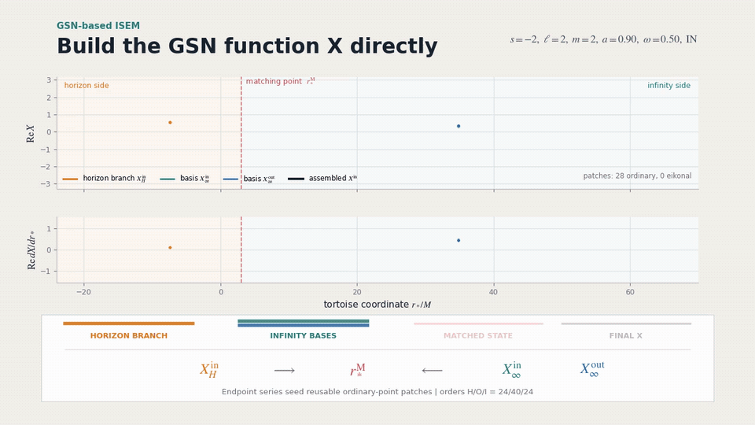
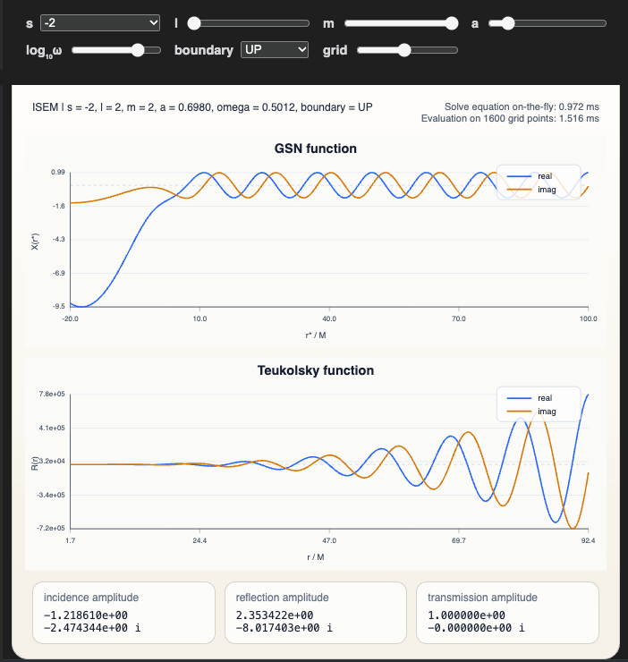

# Home

GeneralizedSasakiNakamura.jl computes solutions to the frequency-domain radial Teukolsky equation with the Generalized Sasaki-Nakamura (GSN) formalism.

The code is capable of handling *both ingoing and outgoing* radiation of scalar, electromagnetic, and gravitational type (corresponding to spin weight of $s = 0, \pm 1, \pm 2$ respectively).

The angular Teukolsky equation is solved with an accompanying julia package [SpinWeightedSpheroidalHarmonics.jl](https://github.com/ricokaloklo/SpinWeightedSpheroidalHarmonics.jl) using a spectral decomposition method.

Both codes are capable of handling *complex* frequencies. Units and the sign, coordinate and normalization conventions are given under [Conventions](@ref).

The paper describing both the GSN formalism and the implementation can be found in [2306.16469](https://arxiv.org/abs/2306.16469). A set of Mathematica notebooks deriving all the equations used in the code can be found in [10.5281/zenodo.8080241](https://doi.org/10.5281/zenodo.8080241).

Starting from v0.8.0, the code is also capable of computing the gravitational waveform amplitude and fluxes at infinity and at the horizon due to a test particle orbiting around a Kerr black hole in a _generic (eccentric, inclined) timelike bound orbit_ by solving the inhomogeneous Sasaki–Nakamura (SN) equation using integration by parts.

Starting from v0.9.0, the package includes the ISEM solver, short for
_iterative series expansion matching_, and a high-level total-flux interface,
[`Teukolsky_pointparticle_flux`](@ref).

Version 0.10.0 replaces the v0.9.0 ISEM solver, which matched series solutions of the Teukolsky equation, with one that solves the generalized Sasaki–Nakamura equation directly (the v0.9.0 controls `rhom`, `TSinInf`, `TSoutInf`, `TSinHor`, `TSoutHor` and the negative `xm` coordinate are removed), and adds a Kerr quasinormal-mode solver, `qnm`. The point-particle mode and flux solvers can be called concurrently from several threads, and calls on the same orbit can share one trajectory and sampling grid through `with_pointparticle_submission` (see [Parallel Calls](@ref)).

In eccentric and generic flux summations, large radial indices $n$ make the convolution integrands highly oscillatory. Each mode with $|n| \ge 50$ (keyword `levin_nmin` of `Teukolsky_pointparticle_flux`) switches automatically from trapezoidal to adaptive Levin quadrature in the radial direction (with Clenshaw–Curtis quadrature in the polar direction for generic orbits) once the trapezoidal grid would be much more expensive, so the quadrature needs no setting beyond the accuracy `tol`.

## Installation
Julia 1.12 or later in the 1.x series is required.

To install the package using the Julia package manager, simply type the following in the Julia REPL:
```julia
using Pkg
Pkg.add("GeneralizedSasakiNakamura")
```

*Note: the dependencies [SpinWeightedSpheroidalHarmonics.jl](https://github.com/ricokaloklo/SpinWeightedSpheroidalHarmonics.jl) (v1.4 or later in the 1.x series) and KerrGeodesics.jl (v0.5) are installed automatically. To call SpinWeightedSpheroidalHarmonics directly with `using SpinWeightedSpheroidalHarmonics`, also run `Pkg.add("SpinWeightedSpheroidalHarmonics")`.*

## Conventions

We use $G = c = M = 1$: frequencies are in units of $1/M$ and radii in units of $M$. The spin `a` is the dimensionless $a/M$, with $-1 \le a \le 1$. Perturbations are proportional to $e^{-i\omega t + i m\phi}$ in Boyer–Lindquist coordinates $(t, r, \theta, \phi)$, so a damped quasinormal mode has $\operatorname{Im}\omega < 0$.

With the horizon radii $r_\pm = 1 \pm \sqrt{1 - a^2}$, the tortoise coordinate (`rstar_from_r`, inverted by `r_from_rstar`) is
```math
r_* = r + \frac{2r_+}{r_+-r_-}\ln\frac{r-r_+}{2} - \frac{2r_-}{r_+-r_-}\ln\frac{r-r_-}{2}
```
for $|a| < 1$, and $r_* = r + 2\ln(r-1) - 2/(r-1) - \ln 4$ at $|a| = 1$.

With $p = \omega - m\Omega_H$, $\Omega_H = a/(2r_+)$ and $\Delta = r^2 - 2r + a^2$, the boundary conditions are `IN`, purely ingoing at the horizon ($\propto e^{-ipr_*}$); `UP`, purely outgoing at infinity ($\propto e^{+i\omega r_*}$); `OUT`, purely outgoing at the horizon ($\propto e^{+ipr_*}$); and `DOWN`, purely ingoing at infinity ($\propto e^{-i\omega r_*}$). `OUT` and `DOWN` are built as linear combinations of `IN` and `UP`. Teukolsky functions returned by `Teukolsky_radial` (`UNIT_TEUKOLSKY_TRANS`) have unit transmission amplitude:
```math
R^{\rm in} \to
\begin{cases}
\Delta^{-s} e^{-ipr_*}, & r \to r_+,\\
B^{\rm inc} r^{-1} e^{-i\omega r_*} + B^{\rm ref} r^{-2s-1} e^{+i\omega r_*}, & r \to \infty,
\end{cases}
\qquad
R^{\rm up} \to
\begin{cases}
C^{\rm inc} e^{+ipr_*} + C^{\rm ref} \Delta^{-s} e^{-ipr_*}, & r \to r_+,\\
r^{-2s-1} e^{+i\omega r_*}, & r \to \infty,
\end{cases}
```
and their `incidence_amplitude` and `reflection_amplitude` fields hold $B^{\rm inc}$ and $B^{\rm ref}$ (or $C^{\rm inc}$ and $C^{\rm ref}$). GSN functions (`UNIT_GSN_TRANS`) have the same asymptotic forms without the powers of $r$ and $\Delta$, e.g. $X^{\rm in} \to A^{\rm inc} e^{-i\omega r_*} + A^{\rm ref} e^{+i\omega r_*}$ at infinity, and the same fields hold these GSN amplitudes. A real-frequency ISEM GSN function whose rescaling to unit transmission would overflow keeps that scale in `transmission_amplitude` instead.

## Highlights
### Easy to use
The following code snippet lets you solve the (source-free) Teukolsky function (in frequency domain) for the mode $s=-2, \ell=2, m=2, a/M=0.7, M\omega=0.5$ that satisfies the purely-ingoing boundary condition at the horizon, $R^{\textrm{in}}$, and the purely-outgoing boundary condition at spatial infinity, $R^{\textrm{up}}$, respectively:
```julia
using GeneralizedSasakiNakamura # This is going to take some time to pre-compile, mostly due to DifferentialEquations.jl

# Specify which mode to solve
s=-2; l=2; m=2; a=0.7; omega=0.5;

# NOTE: julia uses 'just-ahead-of-time' compilation. Calling this the first time in each session will take some time
Rin, Rup = Teukolsky_radial(s, l, m, a, omega)
```
That's it! In the Julia REPL this displays the mode and the asymptotic amplitudes of both solutions:
```
(
TeukolskyRadialFunction(
    mode = Mode(s = -2, l = 2, m = 2, a = 0.7, omega = 0.5, lambda = 1.6966094016353415),
    boundary_condition = IN,
    transmission_amplitude = 1.0 + 0.0im,
    incidence_amplitude = 6.536587661184236 - 4.941203897065118im,
    reflection_amplitude = -0.1282466191290958 - 0.4404813349644446im,
    normalization_convention = UNIT_TEUKOLSKY_TRANS
),
TeukolskyRadialFunction(
    mode = Mode(s = -2, l = 2, m = 2, a = 0.7, omega = 0.5, lambda = 1.6966094016353415),
    boundary_condition = UP,
    transmission_amplitude = 1.0 + 0.0im,
    incidence_amplitude = -1.1698840333865992 - 2.5455723340434875im,
    reflection_amplitude = 2.5169908586317717 - 8.644964686261376im,
    normalization_convention = UNIT_TEUKOLSKY_TRANS
))
```

For example, if we want to evaluate the Teukolsky function $R^{\textrm{in}}$ at the location $r = 10M$, simply do
```julia
Rin(10)
```
This should give
```
77.57508416830544 - 429.4029095224015im
```

A Teukolsky function is evaluated at the Boyer–Lindquist radius $r$. Passing a boundary condition (`IN`, `UP`, `OUT` or `DOWN`) as a sixth argument returns that single solution, e.g. `Rin = Teukolsky_radial(s, l, m, a, omega, IN)`. `Xin, Xup = GSN_radial(s, l, m, a, omega)` gives the GSN function $X$, which is evaluated at the tortoise coordinate: $X^{\rm in}$ at $r = 10M$ is `Xin(rstar_from_r(a, 10))`, while `Xin(10)` is $X^{\rm in}$ at $r_* = 10M$. `Y_radial(s, l, m, a, omega, bc)` returns the auxiliary function $Y(r)$ for $s = -2$ with `IN` and $s = +2$ with `UP`. See the [API Reference](@ref) for all call forms and keywords.

#### Complex frequencies and quasinormal modes

The radial interfaces accept complex frequencies directly. To find a quasinormal-mode (QNM) frequency, `qnm(a, s, l, m, n)` solves for a root of Leaver's continued fraction (with dedicated methods near and at $|a| = 1$; see [Quasinormal modes](@ref)) and then evaluates the GSN scattering amplitudes and the excitation factor at it by solving the GSN equation. For the $a=0.68$, $s=-2$, $(\ell,m,n)=(2,2,0)$ mode, the ordinary and mirror branches are

```julia
ordinary_mode = qnm(0.68, -2, 2, 2, 0)          # (a, s, l, m, n)
mirror_mode = qnm(0.68, -2, 2, 2, 0, mirror)
```

!!! details "Output"
    ```text
    QuasiNormalMode(
        parameters = (a = 0.68, s = -2, l = 2, m = 2, n = 0)
        omega = 0.52397510429008398 - 0.081512623631199516im
        lambda = 1.6550030612535795 + 0.36026776076186151im
        incidence_amplitude = -2.9652484956329296e-15 + 1.0066747053005698e-14im
        reflection_amplitude = -0.80073261705109955 + 0.029136276807086189im
        incidence_derivative = -2.143807932934116 + 6.7875557748638862im
        excitation_factor = 0.01983394079017144 + 0.10427056860707475im
        formalism = GSN)

    QuasiNormalMode(
        parameters = (a = 0.68, s = -2, l = 2, m = 2, n = 0)
        omega = -0.31116285768546015 - 0.088754663319965579im
        lambda = 5.4219094861401045 + 0.40958044727148446im
        incidence_amplitude = -5.1821813248855796e-15 + 4.7107003677217079e-15im
        reflection_amplitude = -1.2675830722586212 + 0.57434916613852249im
        incidence_derivative = 9.1832313896816231 - 11.990411121525646im
        excitation_factor = 0.13913753384546915 + 0.030226487430463019im
        formalism = GSN)
    ```

`ordinary` (the default) is the mode with $\operatorname{Re}\omega > 0$ and `mirror` the mode with $\operatorname{Re}\omega < 0$. Without `mirror_guess`, the mirror frequency is the reflection $-\bar\omega$ of the ordinary $(s, \ell, -m, n)$ root at the same spin; only when that root is not accepted (and did not stop at the negative imaginary axis) is the mirror root polished on the negative-real branch, starting from the reflection. The mirror amplitudes and excitation factor are evaluated at the mirror frequency.

Both results above are `QNMResult`s (displayed as `QuasiNormalMode`, `status = :accepted`): every accuracy check passed. `qnm` can instead return a `QNMEstimate` (`status = :estimated`: the values are usable, but one check missed its target, for example the `1e-7` drift target of the extrapolated `incidence_derivative`; `limiting_gate` names that check), a `QNMFailure` (`status = :failed`; the failed step is named in `stage`, and with `stage = :root` its `omega` is not a QNM frequency) or, for a zero-damping mode at $a = \pm 1$, a `QNMEndpointResult` (`status = :accepted`, amplitudes `missing`). Test the type, e.g. `ordinary_mode isa QNMResult`, because `status` does not separate a `QNMEndpointResult` from a `QNMResult`; the [Quasinormal modes](@ref) page lists all cases.

The computed frequency can be passed directly to the radial interfaces without truncating its digits:

```julia
Rin, Rup = Teukolsky_radial(-2, 2, 2, 0.68, ordinary_mode.omega)
```

```julia
julia> Rup
TeukolskyRadialFunction(
    mode = Mode(s = -2, l = 2, m = 2, a = 0.68, omega = 0.523975104290084 - 0.08151262363119952im, lambda = 1.6550030612535795 + 0.3602677607618615im),
    boundary_condition = UP,
    transmission_amplitude = 1.0 + 0.0im,
    incidence_amplitude = -1.6277792171253123e-15 + 2.3406653193234936e-16im,
    reflection_amplitude = 1.101161565720053 + 2.1300599921594445im,
    normalization_convention = UNIT_TEUKOLSKY_TRANS
)
```

For a QNM frequency $\omega_q$, the returned `incidence_derivative` and `excitation_factor` are

```math
\alpha^{{\rm GSN}}_{\ell m\omega_q}
=\left.\frac{\partial A^{{\rm GSN},{\rm inc}}_{\ell m\omega}}
{\partial\omega}\right|_{\omega=\omega_q},
\qquad
B^{{\rm GSN}}_{\ell m\omega_q}
=\frac{A^{{\rm GSN},{\rm ref}}_{\ell m\omega_q}}
{2\omega_q\alpha^{{\rm GSN}}_{\ell m\omega_q}},
```

where $A^{{\rm GSN},{\rm inc}}$ and $A^{{\rm GSN},{\rm ref}}$ are the amplitudes of the GSN `IN` solution with unit transmission. `qnm` returns them as `incidence_amplitude` and `reflection_amplitude`, so they differ from the Teukolsky-normalized amplitudes printed by `Teukolsky_radial`. At extra cost, `detailed=true` also returns the Teukolsky-normalized excitation factor `result.teukolsky.excitation_factor`, the callable `IN` solutions `result.X(rstar)` and `result.R(r)`, and `result.Y(r)` (`IN` for $s = -2$, `UP` for $s = +2$, `missing` otherwise).

See [Quasinormal modes](@ref) for overtone labels, segments and the root-only interface.

#### Solving the inhomogeneous radial Teukolsky/SN equation with a point-particle source on a generic timelike bound orbit
An orbit is specified by the black-hole spin $a$, the semi-latus rectum $p$, the eccentricity $e$ and the inclination parameter $x = \cos\theta_{\rm inc}$ ($x = 1$ for a prograde and $x = -1$ for a retrograde equatorial orbit). A mode is labeled by $(s, \ell, m, n, k)$, where $n$ and $k$ are the radial and polar harmonic indices.
Suppose we want to compute the inhomogeneous solution to the radial Teukolsky equation at infinity for the $s = -2$, $\ell = m = 2$, $n = k = 0$ mode driven by a test particle on a bound geodesic with $a/M = 0.9, p = 6M, e = 0.7, x = \cos(\pi/4)$, one can simply do
```julia
mode_info = Teukolsky_pointparticle_mode(-2, 2, 2, 0, 0, 0.9, 6, 0.7, cos(π/4))  # (s, l, m, n, k, a, p, e, x)
```
To have a glimpse of the output, one can do so with
```julia
julia> mode_info
TeukolskyPointParticleMode(
    mode = Mode(s = -2, l = 2, m = 2, n = 0, k = 0, a = 0.9, omega = 0.06568724726732753, lambda = 3.606789012119982),
    amplitude_inf = 0.00023429507956768906 - 6.558414441160938e-5im,
    energy_flux_inf = 1.0917330113048546e-6,
    angular_momentum_flux_inf = 3.324033375494718e-5,
    Carter_const_flux_inf = 5.890504443058139e-5,
    method = (method = "isem_trapezoidal", radial_method = "ISEM", radial_sfe = false, N = 256, K = 64, truncation_floor = 1.0e-16),
)
```
To access for example the amplitude at infinity
```julia
julia> mode_info.amplitude
0.00023429507956768906 - 6.558414441160938e-5im
```
which is the value for $Z^{\infty}_{\ell m n k}$, the amplitude of the inhomogeneous radial Teukolsky solution near infinity for that particular frequency.
The suffix `_inf` (`_hor` for $s = +2$) appears only in the display; the fields are `amplitude`, `energy_flux`, `angular_momentum_flux` and `Carter_const_flux`.
The particle mass $\mu$ is not an input: amplitudes are given per unit $\mu$ and fluxes per unit $\mu^2$. The fluxes are time-averaged rates; for $s = -2$, the energy flux of one mode at infinity is $|Z^{\infty}_{\ell m n k}|^2/(4\pi\omega^2)$.

If we want to compute the inhomogeneous solution to the radial Teukolsky equation at the event horizon for the 
same set of parameters, we can simply change the sign of $s$ to $2$
```julia
mode_info = Teukolsky_pointparticle_mode(2, 2, 2, 0, 0, 0.9, 6, 0.7, cos(π/4))
```
The output should be
```julia
julia> mode_info
TeukolskyPointParticleMode(
    mode = Mode(s = 2, l = 2, m = 2, n = 0, k = 0, a = 0.9, omega = 0.06568724726732753, lambda = -0.39321098788001757),
    amplitude_hor = 0.006089946888790668 - 0.0014130019665083518im,
    energy_flux_hor = -2.843814878429853e-9,
    angular_momentum_flux_hor = -8.658651402627282e-8,
    Carter_const_flux_hor = -1.5343956812851395e-7,
    method = (method = "isem_trapezoidal", radial_method = "ISEM", radial_sfe = false, N = 256, K = 64, truncation_floor = 1.0e-16),
)
```
To access for example the amplitude at the horizon
```julia
julia> mode_info.amplitude
0.006089946888790668 - 0.0014130019665083518im
```
which is the value for $Z^{\mathrm{H}}_{\ell m n k}$, the amplitude of the inhomogeneous radial Teukolsky solution near the horizon for that particular frequency.
Horizon fluxes are the rates absorbed by the black hole, so the energy flux is negative for superradiant modes, $\omega(\omega - m\Omega_H) < 0$, as in this example. At infinity and at the horizon, the angular-momentum flux of a mode is $m/\omega$ times its energy flux.

#### Total fluxes

`Teukolsky_pointparticle_flux(a, p, e, x)` sums the mode fluxes to the relative tolerance `tol` (default `1e-8`). It chooses the summation from the orbit: circular for $e = 0$, $|x| = 1$; eccentric for $|x| = 1$; inclined for $e = 0$; generic otherwise. For parameters that are neither a stable bound orbit nor a marginally stable bound circular orbit, it warns and returns `nothing`. Generic orbits need two-dimensional convolution integrals and many more modes: in the examples below, timed after an earlier call had compiled the code, the circular orbit took about 0.3 seconds and the generic orbit, with about 1.3 million modes, about 22 minutes; all four examples cost 0.6–1 ms per mode. The printed `convolution_integral` entry (`flux.reached.convolution_integral`) reports the quadrature used; "tail ISEM adaptive Levin enabled but not triggered" means that Levin quadrature was never selected.

!!! details "Circular equatorial orbit"
    ```julia
    julia> flux = Teukolsky_pointparticle_flux(0.9, 6.0, 0.0, 1.0; tol=1e-8)
    TeukolskyPointParticleFlux(
        orbital_parameters(a = 0.9, p = 6.0, e = 0.0, x = 1.0),
        orbit_type = circular,
        infinity_energy_flux = 0.0005658659548571375,
        infinity_angular_momentum_flux = 0.008825776472648025,
        infinity_carter_constant_flux = 0.0,
        horizon_energy_flux = -4.177363290666302e-6,
        horizon_angular_momentum_flux = -6.515407815579624e-5,
        horizon_carter_constant_flux = 0.0,
        total_modes = 378,
        l_reached = (infinity = 19, horizon = 12),
        convolution_integral = (strategy = "no convolution integral is needed",),
        tolerance = 1.0e-8,
        truncation_floor = (infinity = 1.0e-16, horizon = 1.0e-16),
        cost = 0.3374300003051758 seconds,
    )
    ```

!!! details "Spherical (inclined circular) orbit"
    ```julia
    julia> flux = Teukolsky_pointparticle_flux(0.9, 6.0, 0.0, 0.5; tol=1e-8)
    TeukolskyPointParticleFlux(
        orbital_parameters(a = 0.9, p = 6.0, e = 0.0, x = 0.5),
        orbit_type = inclined,
        infinity_energy_flux = 0.0006637621566020543,
        infinity_angular_momentum_flux = 0.0060183149433979885,
        infinity_carter_constant_flux = 0.04294455189603736,
        horizon_energy_flux = -3.086574922405825e-6,
        horizon_angular_momentum_flux = -0.00010495330048599916,
        horizon_carter_constant_flux = 8.871154473181861e-5,
        total_modes = 11466,
        k_reached_inf = 15,
        k_reached_hor = 13,
        convolution_integral = (strategy = "ISEM adaptive trapezoidal for all modes",),
        tolerance = 1.0e-8,
        truncation_floor = (infinity = 1.0e-16, horizon = 1.0e-16),
        cost = 10.32890009880066 seconds,
    )
    ```

!!! details "Eccentric equatorial orbit"
    ```julia
    julia> flux = Teukolsky_pointparticle_flux(0.9, 6.0, 0.7, 1.0; tol=1e-8)
    TeukolskyPointParticleFlux(
        orbital_parameters(a = 0.9, p = 6.0, e = 0.7, x = 1.0),
        orbit_type = eccentric,
        infinity_energy_flux = 0.0007457787885708398,
        infinity_angular_momentum_flux = 0.006759517700914085,
        infinity_carter_constant_flux = 0.0,
        horizon_energy_flux = -8.777498432552538e-6,
        horizon_angular_momentum_flux = -7.361786661019827e-5,
        horizon_carter_constant_flux = 0.0,
        total_modes = 45204,
        n_reached = (infinity = 124, horizon = 58),
        convolution_integral = (strategy = "ISEM adaptive trapezoidal for all computed n; tail ISEM adaptive Levin enabled but not triggered", tail_levin_nmin = 50, tail_levin_local_n = 16, tail_levin_max_depth = 8),
        tolerance = 1.0e-8,
        truncation_floor = (infinity = 1.0e-16, horizon = 1.0e-16),
        cost = 26.141580820083618 seconds,
    )
    ```

!!! details "Generic orbit"
    ```julia
    julia> flux = Teukolsky_pointparticle_flux(0.9, 6.0, 0.7, 0.5; tol=1e-8)
    TeukolskyPointParticleFlux(
        orbital_parameters(a = 0.9, p = 6.0, e = 0.7, x = 0.5),
        orbit_type = generic,
        infinity_energy_flux = 0.0011469130759772415,
        infinity_angular_momentum_flux = 0.006380279789657716,
        infinity_carter_constant_flux = 0.04146329448763504,
        horizon_energy_flux = -9.200412363629793e-6,
        horizon_angular_momentum_flux = -0.0003627225703136506,
        horizon_carter_constant_flux = 0.0009653818407530993,
        total_modes = 1319722,
        n_reached = (infinity = 145, horizon = 84),
        convolution_integral = (strategy = "ISEM adaptive trapezoidal for all computed n; tail ISEM adaptive Levin enabled but not triggered", tail_levin_nmin = 50, tail_levin_local_n = 16, tail_levin_max_depth = 8),
        tolerance = 1.0e-8,
        truncation_floor = (infinity = 1.0e-16, horizon = 1.0e-16),
        cost = 1306.2777690887451 seconds,
    )
    ```

### Numerical solver path: linear/Riccati integration
With `method = "linear"` or `method = "Riccati"`, the GSN equation is integrated numerically on a tortoise-coordinate interval `[rsin, rsout]` and smoothly joined to asymptotic series near the horizon and infinity, so the solution can be evaluated at any radius:

```@raw html
<p align="center">
  
</p>
```

`rsin` and `rsout` are the 7th and 8th positional arguments, as in `Teukolsky_radial(s, l, m, a, omega, IN, rsin, rsout; method = "linear")`; for real frequencies and $|a| < 1$, calls without them use $r_* = -50$ and $r_* = 1000$. ISEM (tried first by the default `method = "auto"`) ignores them. The linear/Riccati methods widen `[rsin, rsout]` for $0.9 < |a| < 1$ and for $|\omega| < 0.03$ (by how much depends on the call form and on whether `method = "auto"` fell back to them; see the [API Reference](@ref)), and below $|\omega| = 10^{-8}$ they lose the `UP` solution, so use ISEM there. For complex `omega` they integrate along a rotated contour in the complex $r_*$ plane, and the resulting GSN function takes the contour parameter $\rho$ instead of $r_*$.

The on-the-fly benchmark against the Mathematica implementation of the Mano–Suzuki–Takasugi (MST) method is shown below:
```@raw html
<table>
  <tr>
    <th>GeneralizedSasakiNakamura.jl numerical solver</th>
    <th><a href="https://github.com/BlackHolePerturbationToolkit/Teukolsky">Teukolsky</a> Mathematica package using the MST method </th>
  </tr>
  <tr>
    <td><p align="center"></p></td>
    <td><p align="center"></p></td>
  </tr>
</table>
```

*(There was no caching in this benchmark; the equation was solved on the fly. The animation was made with an earlier version of [examples/realtime-demo.ipynb](https://github.com/ricokaloklo/GeneralizedSasakiNakamura.jl/blob/main/examples/realtime-demo.ipynb), which now runs the ISEM solver.)*

### Semi-analytical solver path: ISEM
ISEM constructs the GSN function $X$ directly, by matching series expansions of
the generalized Sasaki–Nakamura equation, and derives the Teukolsky function $R$
and the auxiliary function $Y$ used by the point-particle convolutions from the same matched solution.
For `GSN_radial` and `Teukolsky_radial`, the default `method = "auto"` tries ISEM
first and, if ISEM throws an error, logs a warning and uses the linear/Riccati
solvers above, unless a matching point `xm` was given (then the error is raised).
`Y_radial` with `"auto"`, and every function with `method = "ISEM"`, use ISEM with
no fallback; `method = "linear"` or `"Riccati"` select those solvers directly.
The optional ISEM controls are the matching point `xm` (in the compact coordinate
$x = (r - r_+)/(r - r_-)$; it must lie in $(0, 1)$), the expansion order `N`,
the tolerance `tol`, and the small- and large-frequency expansion switches `sfe`
and `lfe`.

```@raw html
<p align="center">
  
</p>
```

The GSN-ISEM on-the-fly solve and evaluation speed:

```@raw html
<p align="center">
  
</p>
```

### Special frequencies and extremal spin
These cases are handled in the same way for every `method`:

- At $\omega = 0$ exactly, `Teukolsky_radial` and `GSN_radial` return the closed-form static `IN` and `UP` solutions, written with Gauss hypergeometric functions (`OUT` and `DOWN` are not available there); their incidence and reflection amplitudes are `missing`, and for `GSN_radial` the transmission amplitude is `missing` too. `Y_radial` requires a nonzero `omega`. Small nonzero frequencies keep the finite-frequency boundary conditions.
- At exactly the superradiant threshold $\omega = m\Omega_H$ with $|a| < 1$, the `UP` solution is built with ISEM using a logarithmic solution at the horizon; its incidence and reflection amplitudes are the coefficients of that logarithmic horizon basis.
- At $|a| = 1$, an exact-extremal solver is used.

## How to cite
If you have used this code in your research that leads to a publication, please cite the following article:
```
@article{Lo:2023fvv,
    author = "Lo, Rico K. L.",
    title = "{Recipes for computing radiation from a Kerr black hole using a generalized Sasaki-Nakamura formalism: Homogeneous solutions}",
    eprint = "2306.16469",
    archivePrefix = "arXiv",
    primaryClass = "gr-qc",
    doi = "10.1103/PhysRevD.110.124070",
    journal = "Phys. Rev. D",
    volume = "110",
    number = "12",
    pages = "124070",
    year = "2024"
}
```

Additionally, if you have used this code's capability to solve for solutions with complex frequencies, please also cite the following article:
```
@article{Lo:2025njp,
    author = "Lo, Rico K. L. and Sabani, Leart and Cardoso, Vitor",
    title = "{Quasinormal modes and excitation factors of Kerr black holes}",
    eprint = "2504.00084",
    archivePrefix = "arXiv",
    primaryClass = "gr-qc",
    doi = "10.1103/PhysRevD.111.124002",
    journal = "Phys. Rev. D",
    volume = "111",
    number = "12",
    pages = "124002",
    year = "2025"
}
```

If you have used this code's capability to solve for the gravitational waveform amplitudes and fluxes at infinity and at horizon with a test particle orbiting a Kerr black hole in a generic timelike bound and stable orbit (e.g., for extreme mass ratio inspiral waveforms), please cite the following articles:
```
@article{Yin:2025kls,
    author = "Yin, Yucheng and Lo, Rico K. L. and Chen, Xian",
    title = "{Gravitational radiation from Kerr black holes using the Sasaki-Nakamura formalism: waveforms and fluxes at infinity}",
    eprint = "2511.08673",
    archivePrefix = "arXiv",
    primaryClass = "gr-qc",
    doi = "10.1103/9ngz-k1lr",
    journal = "Phys. Rev. D",
    volume = "113",
    number = "12",
    pages = "124007",
    year = "2026"
}

@article{Lo:2025lpo,
    author = "Lo, Rico K. L. and Yin, Yucheng",
    title = "{Near-horizon gravitational perturbations of rotating black holes}",
    eprint = "2512.07937",
    archivePrefix = "arXiv",
    primaryClass = "gr-qc",
    doi = "10.1103/bljh-l413",
    journal = "Phys. Rev. D",
    volume = "113",
    number = "6",
    pages = "L061505",
    year = "2026"
}
```

## License
The package is licensed under the MIT License.
